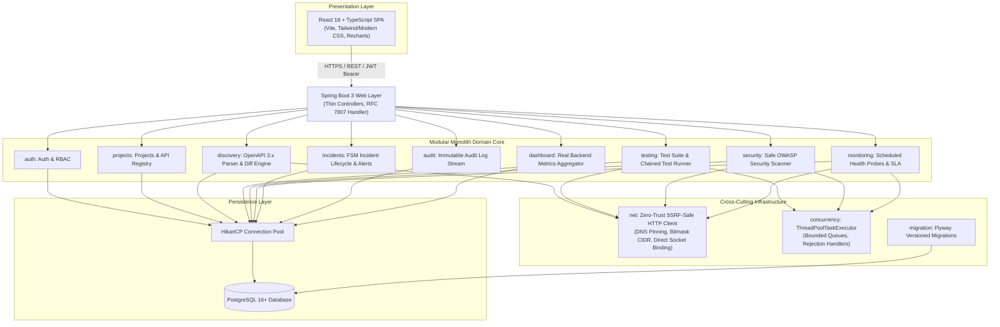
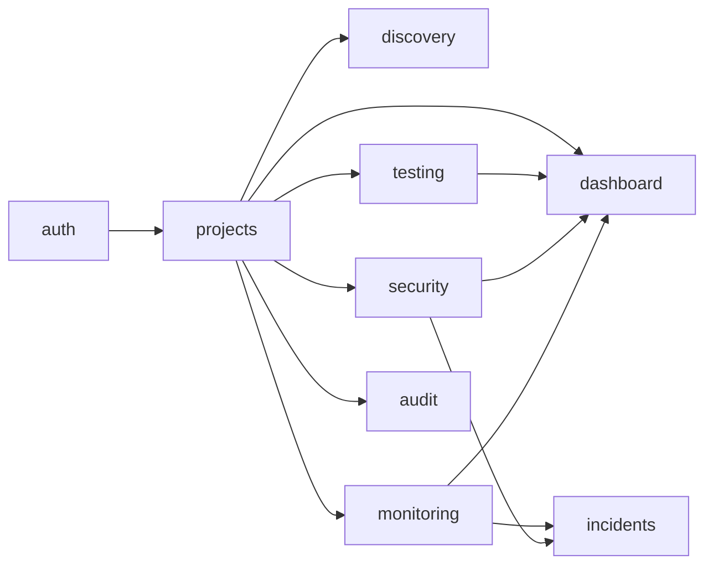
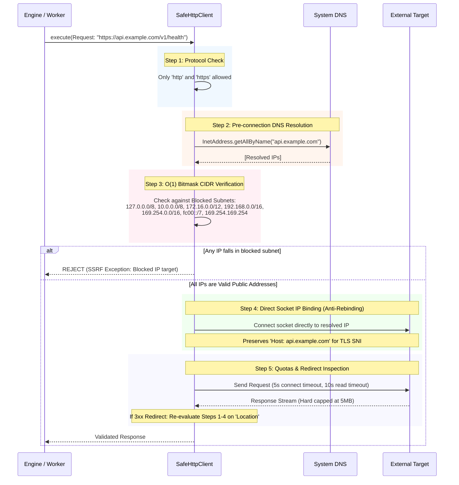
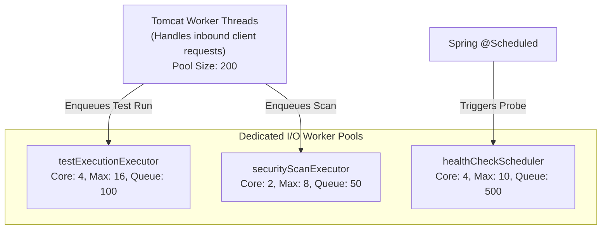
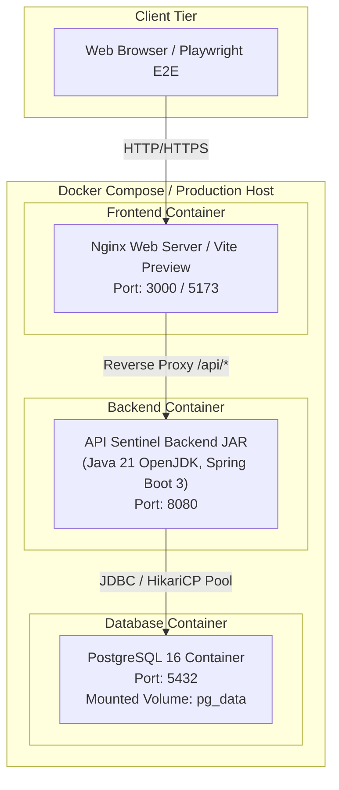

# API Sentinel — Technical Architecture & Engineering Guide

## 1. Architectural Philosophy: The Modular Monolith

### Why a Modular Monolith over Microservices?
In modern engineering discussions and technical interviews, jumping straight to microservices for a greenfield or medium-scale system is an anti-pattern. Microservices introduce distributed transactions, network latency, distributed tracing complexity, partial failure states, and deployment overhead.

Instead, **API Sentinel** is built as a **Modular Monolith**:
- **Single Deployable Unit**: Simplified CI/CD, one JAR executable, lower infrastructure cost, local development simplicity.
- **Strict Logical Boundaries**: Modules communicate via well-defined internal Java APIs / domain service interfaces, not ad-hoc circular dependencies.
- **Isolated Relational Schemas**: Tables are logically grouped by bounded context, preventing cross-domain Spaghetti SQL joins.
- **Future-Proof**: If a module (such as the Security Scanner or Health Probe) experiences heavy computational load, it can be decoupled into an independent microservice or worker pool with minimal refactoring.

---

## 2. Module Boundaries & Dependency Rules

To preserve clean architecture, dependencies between modules must be strictly unidirectional:

### Dependency Rules:
1. **Controllers are Thin**: Controllers perform request routing, Bean Validation trigger (`@Valid`), and response mapping. Zero business logic in controllers.
2. **Business Logic in Services**: All domain logic, authorization verification, state machines, and calculations reside inside dedicated service classes.
3. **DTO Separation**: Internal entities (`@Entity`) are never returned directly from controllers. All ingress and egress data pass through strongly typed Record/Class DTOs.
4. **No Circular Module Dependencies**: Modules never import each other bidirectionally. Cross-module communication uses domain events or well-defined service interfaces.

---

## 3. Deep Dive: Zero-Trust Network Defense & SSRF Protection

### The Attack Vector: Server-Side Request Forgery (SSRF) & DNS Rebinding
When an application accepts target URLs from users to perform HTTP requests (e.g., importing OpenAPI specifications, running test cases, or pinging health endpoints), attackers attempt to:
1. Access internal cloud metadata: `http://169.254.169.254/latest/meta-data/` to steal AWS/GCP/Azure IAM credentials.
2. Scan internal networks: `http://10.0.0.1:8080`, `http://192.168.1.1`.
3. Exploit local services: `http://localhost:5432` (PostgreSQL), `http://127.0.0.1:6379` (Redis).
4. Conduct **DNS Rebinding Attacks**: The attacker controls a domain `rebind.attacker.com`. When our server validates the domain, DNS returns a benign public IP (`93.184.216.34`, TTL = 0). When the HTTP client connects a millisecond later, the DNS server returns `127.0.0.1`.

### The API Sentinel Outbound Defense Architecture

---

## 4. Concurrency & Threading Architecture

Outbound network operations (test executions, security scans, health checks) are fundamentally **I/O-bound**. If not isolated, slow external APIs could starve the Spring Boot web container (Tomcat) of worker threads.

### Thread Isolation Model

### Thread Pool Sizing Principles (Interview Formula)
For I/O-bound tasks where threads spend most time waiting on network responses:
$$\text{Threads} = \text{CPU Cores} \times \left(1 + \frac{\text{Wait Time}}{\text{Service Time}}\right)$$
Because external HTTP pings have high wait-to-service ratios ($\approx 10:1$), bounded worker pools with non-blocking queues prevent system overload while enabling high concurrency.

---

## 5. Deployment Architecture

---

## 6. SDE Interview Mentoring & Architectural Trade-offs

When explaining this architecture in SDE and backend engineering interviews, focus on these critical trade-offs:

### 1. Why Bitmask Integer Matching for CIDR Blocks?
- **Naive Approach**: Checking if string starts with `"192.168."` fails on CIDRs that don't align with octets (e.g., `/12` for `172.16.0.0/12` spans `172.16.0.0` through `172.31.255.255`).
- **Bit Manipulation**: 
  $$\text{NetMask} = \sim((1 \ll (32 - \text{prefix})) - 1)$$
  $$\text{Matches} = (\text{IP\_Int} \ \& \ \text{NetMask}) == \text{Subnet\_Int}$$
  This runs in $O(1)$ operations with zero heap allocation.

### 2. Time-of-Check to Time-of-Use (TOCTOU) in Network Security:
- *Question*: *"Why isn't validating the URL hostname before making the request enough?"*
- *Answer*: *"Because of DNS rebinding. An attacker can set a DNS TTL of 0 seconds. During the validation check, it resolves to a public IP. When the HTTP library opens the socket, it resolves DNS a second time and gets 127.0.0.1. We eliminate this TOCTOU window by pre-resolving the IP, validating it, and pinning the socket connection directly to that specific IP address."*

### 3. Asynchronous Execution with Bounded Queues:
- *Question*: *"What happens if a user triggers 1,000 security scans simultaneously?"*
- *Answer*: *"We never spawn unbounded threads. We use a `ThreadPoolTaskExecutor` with a bounded `ArrayBlockingQueue` and `ThreadPoolExecutor.AbortPolicy` (or custom rejection handler) that translates excess traffic into an HTTP `429 Too Many Requests` or `QUEUED` state, protecting the server against Out-Of-Memory (OOM) crashes."*
