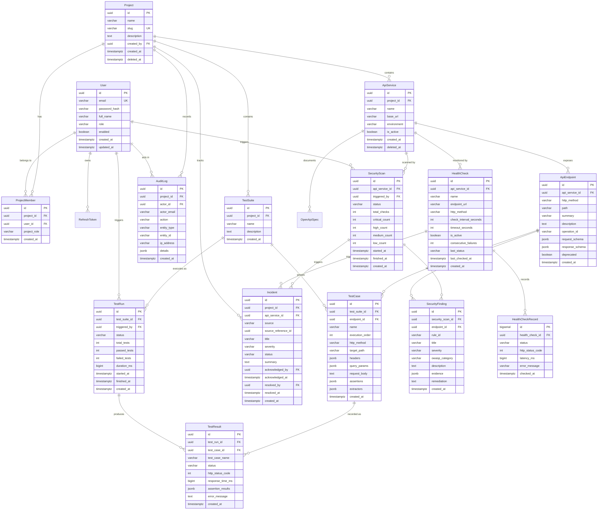

# API Sentinel — Database Design & Entity-Relationship Specification

## 1. Relational Database Strategy (PostgreSQL 16+)

API Sentinel uses **PostgreSQL 16+** with **Flyway** for versioned, deterministic database migrations.

### Core Modeling Principles:
1. **Primary Keys**: UUID (`gen_random_uuid()` / RFC 9562 UUIDv7) for all external-facing domain entities (`User`, `Project`, `ApiEndpoint`, `TestSuite`, `TestCase`, `TestRun`, `SecurityScan`, `Incident`, `AuditLog`) to prevent **Insecure Direct Object Reference (IDOR)** and enumeration attacks. High-volume execution logs (`health_check_records`) use auto-incrementing `BIGSERIAL` to ensure compact B-Tree indexing on append-only streams.
2. **Timestamps**: Strictly `TIMESTAMP WITH TIME ZONE` (`timestamptz`) in **UTC**.
3. **Structured vs JSONB**:
   - Relational columns for high-cardinality join fields, foreign keys, enums, and indexed query targets.
   - PostgreSQL `JSONB` for flexible schema assertions, dynamic HTTP headers, OpenAPI raw schema definitions, and vulnerability evidence payloads.
4. **Soft Deletion**: Applied to `Project`, `ApiService`, and `ApiEndpoint` via `deleted_at IS NULL` with partial unique indexes to ensure audit trail integrity.

---

## 2. Complete Mermaid Entity-Relationship (ER) Diagram



---

## 3. Detailed Entity Specifications & PostgreSQL DDL

### 3.1 Entity 1: `User` & `RefreshToken`
Stores authentication credentials and enables stateless JWT with refresh token rotation.
```sql
CREATE TABLE users (
    id UUID PRIMARY KEY DEFAULT gen_random_uuid(),
    email VARCHAR(255) NOT NULL,
    password_hash VARCHAR(255) NOT NULL,
    full_name VARCHAR(100) NOT NULL,
    role VARCHAR(50) NOT NULL DEFAULT 'ROLE_USER',
    enabled BOOLEAN NOT NULL DEFAULT TRUE,
    created_at TIMESTAMPTZ NOT NULL DEFAULT CURRENT_TIMESTAMP,
    updated_at TIMESTAMPTZ NOT NULL DEFAULT CURRENT_TIMESTAMP
);
CREATE UNIQUE INDEX idx_users_email_lower ON users (LOWER(email));

CREATE TABLE refresh_tokens (
    id UUID PRIMARY KEY DEFAULT gen_random_uuid(),
    user_id UUID NOT NULL REFERENCES users(id) ON DELETE CASCADE,
    token_hash VARCHAR(255) NOT NULL UNIQUE,
    expires_at TIMESTAMPTZ NOT NULL,
    revoked_at TIMESTAMPTZ,
    created_at TIMESTAMPTZ NOT NULL DEFAULT CURRENT_TIMESTAMP
);
CREATE INDEX idx_refresh_tokens_user ON refresh_tokens(user_id);
```

### 3.2 Entity 2: `Project` & `ProjectMember`
Represents isolated workspaces. Multi-tenant security enforces that every resource query validates membership through `project_members`.
```sql
CREATE TABLE projects (
    id UUID PRIMARY KEY DEFAULT gen_random_uuid(),
    name VARCHAR(120) NOT NULL,
    slug VARCHAR(140) NOT NULL,
    description TEXT,
    created_by UUID NOT NULL REFERENCES users(id),
    created_at TIMESTAMPTZ NOT NULL DEFAULT CURRENT_TIMESTAMP,
    updated_at TIMESTAMPTZ NOT NULL DEFAULT CURRENT_TIMESTAMP,
    deleted_at TIMESTAMPTZ
);
CREATE UNIQUE INDEX idx_projects_slug_active ON projects (slug) WHERE deleted_at IS NULL;

CREATE TABLE project_members (
    id UUID PRIMARY KEY DEFAULT gen_random_uuid(),
    project_id UUID NOT NULL REFERENCES projects(id) ON DELETE CASCADE,
    user_id UUID NOT NULL REFERENCES users(id) ON DELETE CASCADE,
    project_role VARCHAR(50) NOT NULL DEFAULT 'VIEWER', -- 'OWNER', 'EDITOR', 'VIEWER'
    created_at TIMESTAMPTZ NOT NULL DEFAULT CURRENT_TIMESTAMP,
    CONSTRAINT uq_project_member UNIQUE (project_id, user_id)
);
CREATE INDEX idx_project_members_user ON project_members(user_id);
```

### 3.3 Entity 3: `ApiService` & `ApiEndpoint`
Represents discovered endpoints grouped under an API Service in a project.
```sql
CREATE TABLE api_services (
    id UUID PRIMARY KEY DEFAULT gen_random_uuid(),
    project_id UUID NOT NULL REFERENCES projects(id) ON DELETE CASCADE,
    name VARCHAR(150) NOT NULL,
    base_url VARCHAR(500) NOT NULL,
    environment VARCHAR(50) NOT NULL DEFAULT 'DEVELOPMENT', -- 'PRODUCTION', 'STAGING', 'DEVELOPMENT'
    description TEXT,
    is_active BOOLEAN NOT NULL DEFAULT TRUE,
    created_at TIMESTAMPTZ NOT NULL DEFAULT CURRENT_TIMESTAMP,
    updated_at TIMESTAMPTZ NOT NULL DEFAULT CURRENT_TIMESTAMP,
    deleted_at TIMESTAMPTZ
);
CREATE INDEX idx_api_services_project ON api_services(project_id) WHERE deleted_at IS NULL;

CREATE TABLE api_endpoints (
    id UUID PRIMARY KEY DEFAULT gen_random_uuid(),
    api_service_id UUID NOT NULL REFERENCES api_services(id) ON DELETE CASCADE,
    http_method VARCHAR(10) NOT NULL, -- GET, POST, PUT, DELETE, PATCH, etc.
    path VARCHAR(500) NOT NULL,
    summary VARCHAR(255),
    description TEXT,
    operation_id VARCHAR(100),
    request_schema JSONB,
    response_schema JSONB,
    deprecated BOOLEAN NOT NULL DEFAULT FALSE,
    created_at TIMESTAMPTZ NOT NULL DEFAULT CURRENT_TIMESTAMP,
    updated_at TIMESTAMPTZ NOT NULL DEFAULT CURRENT_TIMESTAMP,
    CONSTRAINT uq_api_endpoint_method_path UNIQUE (api_service_id, http_method, path)
);
CREATE INDEX idx_api_endpoints_service ON api_endpoints(api_service_id);
```

### 3.4 Entity 4 & 5: `TestSuite` & `TestCase`
Represents functional test suites with ordered or DAG-chained test cases and assertion definitions.
```sql
CREATE TABLE test_suites (
    id UUID PRIMARY KEY DEFAULT gen_random_uuid(),
    project_id UUID NOT NULL REFERENCES projects(id) ON DELETE CASCADE,
    name VARCHAR(150) NOT NULL,
    description TEXT,
    created_at TIMESTAMPTZ NOT NULL DEFAULT CURRENT_TIMESTAMP,
    updated_at TIMESTAMPTZ NOT NULL DEFAULT CURRENT_TIMESTAMP
);
CREATE INDEX idx_test_suites_project ON test_suites(project_id);

CREATE TABLE test_cases (
    id UUID PRIMARY KEY DEFAULT gen_random_uuid(),
    test_suite_id UUID NOT NULL REFERENCES test_suites(id) ON DELETE CASCADE,
    endpoint_id UUID REFERENCES api_endpoints(id) ON DELETE SET NULL,
    name VARCHAR(150) NOT NULL,
    execution_order INT NOT NULL DEFAULT 0,
    http_method VARCHAR(10) NOT NULL,
    target_path VARCHAR(500) NOT NULL,
    headers JSONB DEFAULT '{}'::jsonb,
    query_params JSONB DEFAULT '{}'::jsonb,
    request_body TEXT,
    assertions JSONB NOT NULL DEFAULT '[]'::jsonb,
    extractors JSONB DEFAULT '[]'::jsonb,
    created_at TIMESTAMPTZ NOT NULL DEFAULT CURRENT_TIMESTAMP,
    updated_at TIMESTAMPTZ NOT NULL DEFAULT CURRENT_TIMESTAMP
);
CREATE INDEX idx_test_cases_suite ON test_cases(test_suite_id, execution_order);
```

### 3.5 Entity 6 & 7: `TestRun` & `TestResult`
Represents an asynchronous execution run of a test suite and its granular step-by-step results.
```sql
CREATE TABLE test_runs (
    id UUID PRIMARY KEY DEFAULT gen_random_uuid(),
    test_suite_id UUID NOT NULL REFERENCES test_suites(id) ON DELETE CASCADE,
    triggered_by UUID REFERENCES users(id) ON DELETE SET NULL,
    status VARCHAR(50) NOT NULL DEFAULT 'QUEUED', -- QUEUED, RUNNING, PASSED, FAILED, TIMED_OUT
    total_tests INT NOT NULL DEFAULT 0,
    passed_tests INT NOT NULL DEFAULT 0,
    failed_tests INT NOT NULL DEFAULT 0,
    duration_ms BIGINT,
    started_at TIMESTAMPTZ,
    finished_at TIMESTAMPTZ,
    created_at TIMESTAMPTZ NOT NULL DEFAULT CURRENT_TIMESTAMP
);
CREATE INDEX idx_test_runs_suite ON test_runs(test_suite_id, created_at DESC);

CREATE TABLE test_results (
    id UUID PRIMARY KEY DEFAULT gen_random_uuid(),
    test_run_id UUID NOT NULL REFERENCES test_runs(id) ON DELETE CASCADE,
    test_case_id UUID REFERENCES test_cases(id) ON DELETE SET NULL,
    test_case_name VARCHAR(150) NOT NULL,
    status VARCHAR(50) NOT NULL, -- PASSED, FAILED, ERROR
    http_status_code INT,
    response_time_ms BIGINT NOT NULL,
    assertion_results JSONB NOT NULL DEFAULT '[]'::jsonb,
    error_message TEXT,
    created_at TIMESTAMPTZ NOT NULL DEFAULT CURRENT_TIMESTAMP
);
CREATE INDEX idx_test_results_run ON test_results(test_run_id);
```

### 3.6 Entity 8 & 9: `SecurityScan` & `SecurityFinding`
Represents safe automated security scans and individual findings mapped to OWASP categories.
```sql
CREATE TABLE security_scans (
    id UUID PRIMARY KEY DEFAULT gen_random_uuid(),
    api_service_id UUID NOT NULL REFERENCES api_services(id) ON DELETE CASCADE,
    triggered_by UUID REFERENCES users(id) ON DELETE SET NULL,
    status VARCHAR(50) NOT NULL DEFAULT 'QUEUED', -- QUEUED, RUNNING, COMPLETED, FAILED
    total_checks INT NOT NULL DEFAULT 0,
    critical_count INT NOT NULL DEFAULT 0,
    high_count INT NOT NULL DEFAULT 0,
    medium_count INT NOT NULL DEFAULT 0,
    low_count INT NOT NULL DEFAULT 0,
    started_at TIMESTAMPTZ,
    finished_at TIMESTAMPTZ,
    created_at TIMESTAMPTZ NOT NULL DEFAULT CURRENT_TIMESTAMP
);
CREATE INDEX idx_security_scans_service ON security_scans(api_service_id, created_at DESC);

CREATE TABLE security_findings (
    id UUID PRIMARY KEY DEFAULT gen_random_uuid(),
    security_scan_id UUID NOT NULL REFERENCES security_scans(id) ON DELETE CASCADE,
    endpoint_id UUID REFERENCES api_endpoints(id) ON DELETE SET NULL,
    rule_id VARCHAR(100) NOT NULL,
    title VARCHAR(200) NOT NULL,
    severity VARCHAR(20) NOT NULL, -- CRITICAL, HIGH, MEDIUM, LOW, INFO
    owasp_category VARCHAR(100),
    description TEXT NOT NULL,
    evidence JSONB,
    remediation TEXT NOT NULL,
    created_at TIMESTAMPTZ NOT NULL DEFAULT CURRENT_TIMESTAMP
);
CREATE INDEX idx_security_findings_scan ON security_findings(security_scan_id, severity);
```

### 3.7 Entity 10: `HealthCheck` & `HealthCheckRecord`
Represents periodic SLA monitoring probes and time-series latency/uptime logs.
```sql
CREATE TABLE health_checks (
    id UUID PRIMARY KEY DEFAULT gen_random_uuid(),
    api_service_id UUID NOT NULL REFERENCES api_services(id) ON DELETE CASCADE,
    name VARCHAR(120) NOT NULL,
    endpoint_url VARCHAR(500) NOT NULL,
    http_method VARCHAR(10) NOT NULL DEFAULT 'GET',
    expected_status_code INT NOT NULL DEFAULT 200,
    check_interval_seconds INT NOT NULL DEFAULT 60,
    timeout_seconds INT NOT NULL DEFAULT 5,
    is_active BOOLEAN NOT NULL DEFAULT TRUE,
    consecutive_failures INT NOT NULL DEFAULT 0,
    last_status VARCHAR(20) NOT NULL DEFAULT 'UNKNOWN', -- UP, DOWN, DEGRADED, UNKNOWN
    last_checked_at TIMESTAMPTZ,
    created_at TIMESTAMPTZ NOT NULL DEFAULT CURRENT_TIMESTAMP,
    updated_at TIMESTAMPTZ NOT NULL DEFAULT CURRENT_TIMESTAMP
);
CREATE INDEX idx_health_checks_active ON health_checks(is_active) WHERE is_active = TRUE;

CREATE TABLE health_check_records (
    id BIGSERIAL PRIMARY KEY,
    health_check_id UUID NOT NULL REFERENCES health_checks(id) ON DELETE CASCADE,
    status VARCHAR(20) NOT NULL, -- UP, DOWN
    http_status_code INT,
    latency_ms BIGINT NOT NULL,
    error_message VARCHAR(500),
    checked_at TIMESTAMPTZ NOT NULL DEFAULT CURRENT_TIMESTAMP
);
CREATE INDEX idx_health_records_check_time ON health_check_records(health_check_id, checked_at DESC);
```

### 3.8 Entity 11 & 12: `Incident` & `AuditLog`
Represents operational incident state management and immutable audit event streaming.
```sql
CREATE TABLE incidents (
    id UUID PRIMARY KEY DEFAULT gen_random_uuid(),
    project_id UUID NOT NULL REFERENCES projects(id) ON DELETE CASCADE,
    api_service_id UUID NOT NULL REFERENCES api_services(id) ON DELETE CASCADE,
    source VARCHAR(50) NOT NULL, -- 'HEALTH_CHECK', 'SECURITY_SCAN'
    source_reference_id UUID,
    title VARCHAR(255) NOT NULL,
    severity VARCHAR(20) NOT NULL, -- CRITICAL, HIGH, MEDIUM, LOW
    status VARCHAR(30) NOT NULL DEFAULT 'TRIGGERED', -- TRIGGERED, ACKNOWLEDGED, RESOLVED, AUTO_RECOVERED
    summary TEXT NOT NULL,
    acknowledged_by UUID REFERENCES users(id),
    acknowledged_at TIMESTAMPTZ,
    resolved_by UUID REFERENCES users(id),
    resolved_at TIMESTAMPTZ,
    created_at TIMESTAMPTZ NOT NULL DEFAULT CURRENT_TIMESTAMP,
    updated_at TIMESTAMPTZ NOT NULL DEFAULT CURRENT_TIMESTAMP
);
CREATE INDEX idx_incidents_project_status ON incidents(project_id, status);
CREATE INDEX idx_incidents_service ON incidents(api_service_id);

CREATE TABLE audit_logs (
    id UUID PRIMARY KEY DEFAULT gen_random_uuid(),
    project_id UUID REFERENCES projects(id) ON DELETE SET NULL,
    actor_id UUID REFERENCES users(id) ON DELETE SET NULL,
    actor_email VARCHAR(255),
    action VARCHAR(100) NOT NULL,
    entity_type VARCHAR(50) NOT NULL,
    entity_id VARCHAR(100),
    ip_address VARCHAR(45),
    details JSONB,
    created_at TIMESTAMPTZ NOT NULL DEFAULT CURRENT_TIMESTAMP
);
CREATE INDEX idx_audit_logs_project_time ON audit_logs(project_id, created_at DESC);
```

---

## 4. Flyway Migration Versioning Plan

Migrations are applied sequentially:
- `V1__init_users_and_auth.sql` -> `users`, `refresh_tokens`
- `V2__init_projects_and_services.sql` -> `projects`, `project_members`, `api_services`
- `V3__init_api_endpoints.sql` -> `api_endpoints`, `openapi_specs`
- `V4__init_test_engine.sql` -> `test_suites`, `test_cases`, `test_runs`, `test_results`
- `V5__init_security_scanner.sql` -> `security_scans`, `security_findings`
- `V6__init_health_monitoring.sql` -> `health_checks`, `health_check_records`
- `V7__init_incidents_and_audit.sql` -> `incidents`, `audit_logs`
