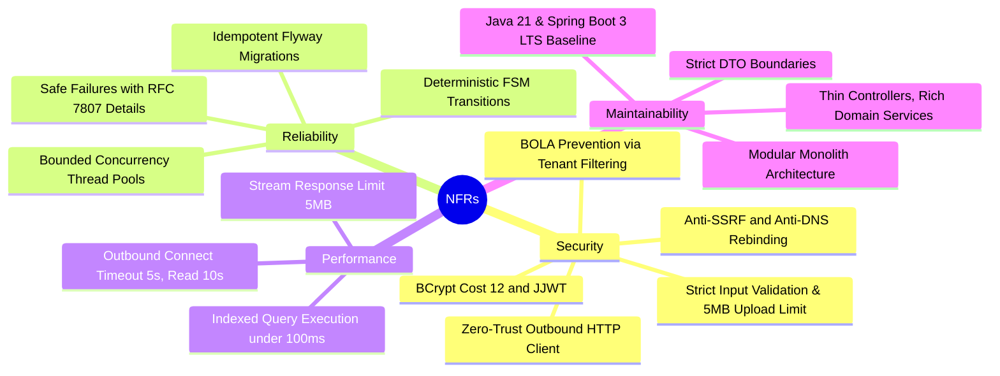

# API Sentinel — Product Requirements Document (PRD)

## 1. Executive Summary
**API Sentinel** is a developer-centric, production-minded API Security, Reliability, and Observability Platform. It solves the critical engineering problem of "API blindspots": organizations deploy dozens to hundreds of microservice endpoints without automated contract drift detection, baseline security posture enforcement (OWASP API Security Top 10), or real-time SLA degradation monitoring.

API Sentinel provides a centralized platform to:
1. Register APIs and import OpenAPI 3.0/3.1 specifications to discover endpoints.
2. Build and run automated functional and regression test suites with assertion chaining.
3. Perform safe, non-destructive, read-only security scans.
4. Continuously monitor endpoint health, latency percentiles, and uptime.
5. Track operational incidents through an automated Finite State Machine (FSM) lifecycle.
6. Review audit logs and inspect real, backend-calculated analytics.

---

## 2. Target Personas & Main User Stories

### Personas
- **Alex (Backend / SDE Intern)**: Wants to verify that endpoints adhere to OpenAPI contracts, automate integration test suites, and detect contract drift before deploying to staging/production.
- **Sam (AppSec / Security Engineer)**: Wants automated security scans that audit transport security, headers, CORS, information leakage, and authentication boundaries without running destructive payloads or violating network boundaries.
- **Morgan (SRE / DevOps Engineer)**: Wants continuous health checks, latency percentiles ($p50$, $p95$, $p99$), uptime tracking, and automated incident alerts when an API breaches its SLA.

---

### Main User Stories

#### Epic 1: Identity & Project Management
- **US-1.1 (Registration & Login)**: *As a developer*, I want to create an account and log in securely via JWT, so that my APIs and test suites are protected.
- **US-1.2 (Project Workspaces)**: *As an engineering lead*, I want to organize APIs and test suites into Projects (e.g., "Payments Gateway", "Customer Auth"), so that teams maintain multi-tenant isolation.
- **US-1.3 (Role-Based Access Control)**: *As a project owner*, I want to assign roles (`OWNER`, `EDITOR`, `VIEWER`) to team members, so that only authorized engineers can trigger scans or delete resources.

#### Epic 2: API Registry & OpenAPI Discovery
- **US-2.1 (API Registration)**: *As a backend engineer*, I want to register an API service with a base URL and environment tag (`PRODUCTION`, `STAGING`, `DEVELOPMENT`), so that API Sentinel knows how to reach it.
- **US-2.2 (OpenAPI Import)**: *As a developer*, I want to upload an OpenAPI (v3.0/v3.1) JSON or YAML file or import it via URL, so that all endpoints and schemas are automatically discovered.
- **US-2.3 (Contract Drift Detection)**: *As a developer*, I want the system to compare newly imported specifications against existing cataloged endpoints, so that I can see added, modified, or deprecated endpoints.

#### Epic 3: Automated Test Suites & Chained Execution
- **US-3.1 (Test Suite Creation)**: *As a QA engineer*, I want to group endpoints into a test suite (e.g., "Smoke Suite", "Checkout Regression"), so that I can run them on demand or on a schedule.
- **US-3.2 (Assertions & Validation)**: *As a QA engineer*, I want to assert HTTP status codes, latency thresholds, response headers, and JSONPath body fields (`$.data.id`), so that I can verify contract correctness.
- **US-3.3 (Chained Test Steps)**: *As an SDE*, I want to extract a value from Step A (e.g., auth token) and pass it into Step B as an Authorization header, so that I can test authenticated multi-step user journeys.
- **US-3.4 (Test Run History)**: *As a developer*, I want to inspect historical test execution runs with exact timing, request dumps, and failure reasons.

#### Epic 4: Safe Security Scanning
- **US-4.1 (Non-Destructive Scans)**: *As a security engineer*, I want to trigger a safe security audit that runs read-only checks (HSTS, CSP, CORS, info disclosure, unauthenticated endpoint access, rate limiting), so that I don't corrupt staging/production data.
- **US-4.2 (Vulnerability Findings)**: *As an SDE*, I want actionable vulnerability reports mapped to OWASP API Security Top 10 with clear remediation guidance and cURL reproduction steps.
- **US-4.3 (SSRF & Target Protection)**: *As an infrastructure engineer*, I want outbound scanner requests to enforce strict SSRF blocks (disallowing private IPs, cloud metadata, and loopback by default), so that API Sentinel cannot be weaponized.

#### Epic 5: Continuous Health Monitoring & Incidents
- **US-5.1 (Health Probes)**: *As an SRE*, I want API Sentinel to ping health endpoints at configurable intervals (e.g., 60 seconds) with latency tracking, so that I know endpoint availability.
- **US-5.2 (Automated Incidents)**: *As an on-call engineer*, I want an incident automatically triggered when a health check fails $N$ consecutive times, so that downtime is flagged immediately.
- **US-5.3 (Incident Resolution Lifecycle)**: *As an on-call engineer*, I want to acknowledge and resolve incidents with root-cause notes, so that incidents are systematically tracked.

#### Epic 6: Observability, Audit & Dashboard
- **US-6.1 (Real-Data Dashboard)**: *As an engineering manager*, I want to view an executive dashboard showing real average uptime, test pass rates, active incidents, and vulnerability severities.
- **US-6.2 (Audit Logging)**: *As a compliance auditor*, I want an immutable audit log of who created, edited, triggered, or deleted resources.

---

## 3. Functional Requirements by Module

| Module | Core Functional Capabilities |
|---|---|
| **1. Auth & RBAC** | • User registration with BCrypt hashing (cost 12) • Stateless JWT authentication (access token 15-60m) + refresh token rotation • Project-level RBAC: `OWNER`, `EDITOR`, `VIEWER` • Broken Object-Level Authorization (BOLA/IDOR) defense at database query layer |
| **2. Projects & Registry** | • Multi-tenant project workspace management • API service registration (base URL, environment, description, allowlist status) • Target host validation |
| **3. OpenAPI Discovery** | • OpenAPI 3.0.x / 3.1.x ingestion (JSON/YAML file upload max 5MB, or SSRF-validated URL fetch) • Endpoint cataloging: HTTP method, path, operationId, request/response schemas • Schema drift diff detection (new, modified, deprecated endpoints) |
| **4. Testing Engine** | • Test suite and test case management • Assertion engine: status code, latency threshold, header presence, JSONPath matching • Sequential & DAG chained execution with variable extraction (`{{token}}`) • Asynchronous execution via dedicated thread pool (`QUEUED`, `RUNNING`, `PASSED`, `FAILED`) |
| **5. Security Scanner** | • Non-destructive scan rules: Transport security, security headers (HSTS, CSP, X-Frame-Options, X-Content-Type-Options), permissive CORS, verbose stack trace leakage, missing authentication on sensitive paths, rate limit presence probe • CVSS severity tagging (`CRITICAL`, `HIGH`, `MEDIUM`, `LOW`, `INFO`) and OWASP mapping |
| **6. Health Monitor** | • Configurable scheduled health pings (e.g., 60s interval, 5s timeout) • Latency recording (ms) and status code tracking • Rolling uptime percentage and latency percentile calculations ($p50$, $p95$, $p99$) |
| **7. Incident Management** | • Automated incident creation on $N$ consecutive probe failures or critical vulnerabilities • Finite State Machine: `TRIGGERED` -> `ACKNOWLEDGED` -> `RESOLVED` / `AUTO_RECOVERED` • Webhook notification dispatching with exponential backoff retry |
| **8. Audit Logging** | • Immutable log stream of all state-altering actions (actor, timestamp, IP, entity, action, diff) • Queryable by project, user, and entity |
| **9. Real Dashboard** | • Real-time aggregated metrics computed dynamically from PostgreSQL tables • Zero mocked or fabricated metrics in production flows • Project-level and platform-level health, scan, and test analytics |

---

## 4. Non-Functional Requirements (NFRs)

1. **Security**:
   - Zero-trust outbound client prevents SSRF: blocks RFC 1918, RFC 3927, RFC 4193, loopback (`127.0.0.0/8`), and cloud metadata (`169.254.169.254`).
   - Anti-DNS rebinding: pre-resolves DNS and directly pins the socket connection to the verified IP.
   - Redirects disabled by default; re-validated per redirect hop if enabled.
   - Passwords hashed with BCrypt (cost 12).
   - JWT tokens signed with HMAC-SHA256 (256-bit key).
   - Object-level security: all queries filtered by user project membership.
2. **Reliability & Consistency**:
   - Asynchronous background tasks (test runs, scans, health probes) execute on bounded thread pools with caller-runs or rejection policies.
   - All timestamps stored in UTC `timestamptz`.
   - API error responses conform to RFC 7807 Problem Details.
3. **Performance & Quotas**:
   - Outbound HTTP checks enforce strict timeouts: 5,000ms connect timeout, 10,000ms read timeout.
   - Response size capped at 5MB to prevent memory exhaustion / zip bomb attacks.
   - Database queries backed by composite indexes, executing under 100ms for p95.
4. **Usability & Frontend**:
   - Responsive modern UI built with React 18, TypeScript, and Vite.
   - Consistent UI states: Loading skeletons, empty states with call-to-action buttons, success banners, and detailed error alerts.

---

## 5. Scope Management: MVP vs Future Enhancements

To guarantee that the project is **achievable, robust, and portfolio-ready for a single student engineer**, we strictly delineate the **MVP Scope** from **Future Enhancements**:

| Feature Area | MVP Scope (Achievable & Production-Grade) | Future Enhancements (Post-MVP) |
|---|---|---|
| **Architecture** | Modular Monolith (Spring Boot 3 + PostgreSQL) | Distributed Microservices with Kafka event streaming |
| **Auth** | Email/Password, BCrypt, JWT Access + Refresh token rotation, Project RBAC | OAuth2 / GitHub / Google SSO, SAML / Enterprise SSO |
| **OpenAPI Import** | Upload JSON/YAML files (max 5MB) + URL fetch with SSRF check; OpenAPI 3.0/3.1 parser | Real-time live traffic passive sniffing / eBPF gateway probe |
| **Testing Engine** | Sequential & variable-chained HTTP test execution, JSONPath assertions, status & latency checks | Distributed load testing (100k req/s), distributed k6 integration |
| **Security Scanner** | 6 core safe, read-only rules (HSTS, CSP, CORS, info disclosure, unauth paths, rate limits) | Dynamic interactive AST fuzzing, automated SQLi/XSS exploit generation |
| **Health Monitoring**| Scheduled ping probes (60s default), uptime calculation, $p50/p95/p99$ percentiles | Multi-region probe mesh (probing from US, EU, Asia simultaneously) |
| **Incidents** | Automated creation on $N$ failures, FSM lifecycle, Slack/Discord webhooks | PagerDuty / OpsGenie on-call phone escalation schedules |
| **Dashboard** | Real aggregate SQL queries for uptime, pass rate, active incidents, vulnerabilities | Machine learning anomaly detection on latency time-series |

---

## 6. Core System Invariants

1. **Zero Fake Data Invariant**: Never return simulated or hardcoded dashboard metrics, test runs, or scan reports. Every metric reflects true database state.
2. **Zero SSRF Invariant**: Never send an unvalidated outbound HTTP request to private, loopback, or metadata addresses.
3. **Zero BOLA Invariant**: Never expose or mutate a project entity without verifying the requesting user's membership and permissions.
4. **Zero Silent Failures**: Never swallow exceptions. Log meaningful context without leaking sensitive credentials or payload tokens.
