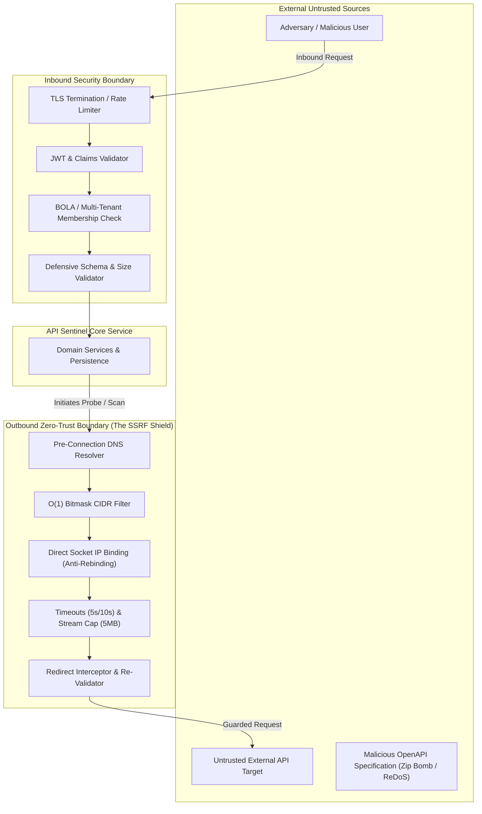
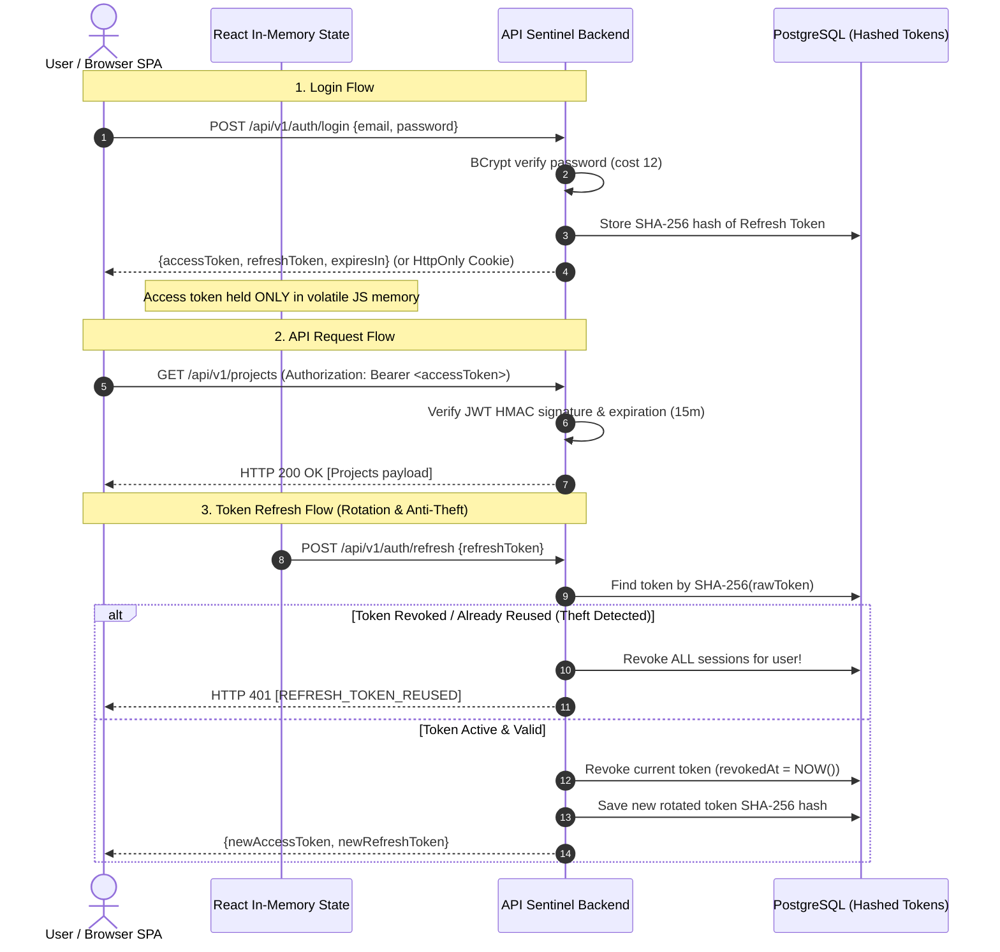

# API Sentinel — Security Threat Model & Outbound Network Policy

## 1. Executive Security Architecture

API Sentinel functions as an active API evaluation platform. Because it accepts user-supplied target URLs, parses untrusted specifications, and executes outbound network requests, it operates in a high-risk operational domain.

This document defines the **Threat Model (STRIDE)**, the **Zero-Trust Outbound Request Policy**, and the **Inbound Application Security Controls** that govern every phase of development.



---

## 2. STRIDE Threat Analysis Matrix

| Threat Category | Specific Attack Vector | Potential Impact | Mitigation in API Sentinel |
|---|---|---|---|
| **Spoofing** | Forged JWT access tokens or stolen refresh tokens | Unauthorized impersonation of users or admins | • HMAC-SHA256 with 256-bit+ secret key<br>• Enforce token expiration (15-60 min)<br>• One-time-use refresh token rotation with immediate revocation on reuse detection |
| **Tampering** | Intercepting and altering outbound scan payloads or database records | Corrupted test reports or scan evasion | • Enforce HTTPS for all outbound communications<br>• Database migrations managed via immutable Flyway scripts<br>• DTO validation preventing mass-assignment |
| **Repudiation** | User denies triggering a critical scan or deleting a project | Lack of accountability | • Immutable `audit_logs` table tracking actor ID, action, target entity, timestamp (UTC), and client IP |
| **Information Disclosure** | • Leaking internal AWS/GCP cloud metadata via SSRF<br>• Leaking database exceptions or stack traces to UI | Compromised cloud infrastructure or database exposure | • Zero-trust outbound client blocks `169.254.169.254`<br>• Global `@RestControllerAdvice` formats errors as RFC 7807 Problem Details without exposing internal stack traces |
| **Denial of Service** | • Spec upload zip bombs or billion laughs XML attacks<br>• Slowloris / infinite response streams from scanned targets | Backend thread starvation and Out-Of-Memory (OOM) | • Hard 5MB upload limit on OpenAPI files<br>• Connect timeout (5s) and read timeout (10s)<br>• Response stream byte quota (hard cutoff at 5MB)<br>• Bounded thread pools with rejection policies |
| **Elevation of Privilege** | Broken Object-Level Authorization (BOLA/IDOR): User A accesses Project B's tests | Multi-tenant data breach | • Enforce project membership check on every repository query (`WHERE project_id = :pId AND user_id = :uId`)<br>• Method-level `@PreAuthorize` security checks |

---

## 3. Safe Outbound Request Policy (The SSRF Defense Engine)

Outbound HTTP requests are executed by the **Testing Engine**, **Security Scanner**, and **Health Monitor**. Outbound requests are treated as untrusted operations subject to strict network confinement.

### 3.1 Destination Blocklist (RFC Subnets & Cloud Metadata)
Every resolved IP address is verified against the following blocklist before opening a TCP connection:

| IP Category | Subnet / Address Range | Risk Rationale |
|---|---|---|
| **Loopback** | `127.0.0.0/8`, `::1` | Prevents accessing local DB (Postgres 5432), Redis (6379), or local host services. |
| **Private (RFC 1918)** | `10.0.0.0/8`<br>`172.16.0.0/12`<br>`192.168.0.0/16` | Prevents pivoting into internal VPCs, Kubernetes pod networks, or corporate intranets. |
| **Link-Local & Cloud Metadata** | `169.254.0.0/16`<br>`fe80::/10`<br>`169.254.169.254` | Prevents theft of AWS EC2 IAM metadata, GCP compute tokens, or Azure IMDS credentials. |
| **Unique Local IPv6** | `fc00::/7` | Prevents internal IPv6 intranet reconnaissance. |
| **Multicast & Broadcast** | `224.0.0.0/4`, `255.255.255.255/32` | Prevents network-level spoofing or amplification attacks. |
| **Google Cloud Metadata** | `metadata.google.internal` | Prevents GCP metadata queries via internal DNS resolution. |

### 3.2 Time-of-Check to Time-of-Use (TOCTOU) & DNS Rebinding Protection
A standard URL check (`if (isPrivate(url.getHost())) abort();`) is fundamentally insecure against **DNS Rebinding**:
- Attacker points `attacker.com` to their own DNS server.
- Request 1: Our check resolves `attacker.com` $\rightarrow$ `93.184.216.34` (Public IP, TTL = 0). Validation passes.
- Request 2: The HTTP client connects, re-resolves DNS $\rightarrow$ `127.0.0.1`. The client connects to localhost!

#### The API Sentinel Direct Socket Pinning Algorithm:
1. **Resolve**: Query DNS once using `InetAddress.getAllByName(host)`.
2. **Validate**: Check every returned IP against the CIDR blocklist using $O(1)$ bitwise masking. If any IP matches a blocked subnet, abort immediately.
3. **Pin**: Bind the HTTP client connection directly to the pre-validated IP address.
4. **Preserve Host**: Retain the original domain name in the HTTP `Host` header and TLS Server Name Indication (SNI) extension to support virtual hosts and TLS handshakes.

### 3.3 HTTP Redirect Policy
1. Automatic following of HTTP redirects (`301`, `302`, `307`, `308`) is **DISABLED BY DEFAULT** for all scanning and health probe operations.
2. If redirects are explicitly enabled for a specific test case:
   - Maximum redirect hops: **3 hops**.
   - Every redirect target (`Location` header) must be intercepted and re-validated through the complete SSRF validation pipeline (Scheme check $\rightarrow$ DNS resolve $\rightarrow$ CIDR check $\rightarrow$ Socket pin).
   - Redirects to local/private addresses are blocked unconditionally.

### 3.4 Quotas & Resource Confinement
- **Connect Timeout**: 5,000 milliseconds.
- **Read Timeout**: 10,000 milliseconds.
- **Maximum Response Body Size**: 5,242,880 bytes (5 MB). If a target streams more than 5MB, the connection is forcibly terminated, and the test/scan records a `RESPONSE_SIZE_EXCEEDED` warning.
- **Rate Limiting**: Scanning engine enforces a default maximum of 10 requests per second per target host to avoid triggering DDoS defenses or impacting target availability.

### 3.5 Target Scope & Authorization Policy
- **Read-Only Scanner Invariant**: The Security Scanner only executes safe, non-destructive HTTP methods (`GET`, `HEAD`, `OPTIONS`). It never performs destructive operations (`POST`, `PUT`, `DELETE`, `PATCH`) against external targets without explicit test suite configuration by the user.
- **Target Allowlisting**: Users must explicitly register API hosts in their project before scanning is permitted.
- **Local Development Mode**: For development and testing environments, scanning loopback/private IPs is disabled unless an explicit configuration flag is set (`api-sentinel.security.allow-local-targets=true`). This flag is hard-disabled in production builds.

---

## 4. Inbound Application Security Architecture

### 4.1 Authentication & Password Security
- Passwords hashed using **BCrypt** with an adaptive work factor of **12** (4,096 iterations), resistant to GPU hash-cracking.
- Passwords must meet complexity requirements: Minimum 10 characters, including at least one uppercase letter, one lowercase letter, one number, and one special character.
- Stateless authentication using **JJWT** signed with **HMAC-SHA256**. Secrets must be at least 256 bits (32 bytes) loaded from environment variables (`JWT_SECRET`).
- Refresh tokens are stored hashed (SHA-256) in the database. When a refresh token is used, it is revoked and replaced with a new token (Refresh Token Rotation).

### 4.2 Broken Object-Level Authorization (BOLA / IDOR) Defense
- Entity IDs use **UUIDv7 / Random UUIDs** rather than sequential integers, preventing enumeration attacks.
- Access to any project resource (`ApiService`, `ApiEndpoint`, `TestSuite`, `TestCase`, `Incident`) is validated at the persistence layer:
  ```java
  @Query("SELECT s FROM ApiService s JOIN ProjectMember m ON m.project.id = s.project.id " +
         "WHERE s.id = :serviceId AND m.user.id = :userId")
  Optional<ApiService> findByIdAndUserId(UUID serviceId, UUID userId);
  ```
- Method security (`@PreAuthorize("@projectSecurity.hasRole(#projectId, 'EDITOR')")`) validates RBAC permissions before service execution.

### 4.3 Safe Ingestion of OpenAPI Specifications
- Uploaded specifications are restricted to 5MB.
- Parsed using `io.swagger.parser.OpenAPIV3Parser` configured to disable external entity resolution (preventing XXE attacks).
- Specification content is treated as untrusted text. Scripts and HTML tags embedded in summaries/descriptions are sanitized before presentation to prevent Cross-Site Scripting (XSS).
- Recursive schema references (e.g., self-referential models) are intercepted with a maximum recursion depth limit of 10 to prevent stack overflow crashes.

### 4.4 Defense-in-Depth Logging Invariants
- Logs must **NEVER** output:
  - User passwords or password hashes.
  - JWT tokens or session secrets.
  - Target Authorization headers or API keys.
  - Full request/response bodies containing PII.
- All sensitive HTTP headers (`Authorization`, `Cookie`, `X-Api-Key`) are automatically masked (`Bearer ********`) before saving to test result tables or emitting to log streams.

### 4.5 Browser Token Storage Strategy & CSRF Mitigation
A critical security decision in single-page applications (SPAs) is where and how authentication tokens are stored in the client runtime. Storing persistent JWT access tokens in `localStorage` or `sessionStorage` leaves applications vulnerable to credential theft via Cross-Site Scripting (XSS), as any injected third-party JavaScript or compromised npm dependency can execute `localStorage.getItem('token')` and exfiltrate the credential.

API Sentinel implements a defense-in-depth **Two-Tier Token Strategy**:



#### Client Storage Architecture Comparison:

| Storage Location | XSS Vulnerability | CSRF Vulnerability | Mitigations / Implementation Pattern |
|---|---|---|---|
| **`localStorage` / `sessionStorage`** | **CRITICAL**: Completely accessible to any executing script (`document.cookie` or direct storage read). Token exfiltration is trivial. | Immune to CSRF (tokens are not automatically attached by browser). | **REJECTED FOR ACCESS TOKENS**. Forbidden by API Sentinel architecture. |
| **Volatile In-Memory JS Variable (React State / Context)** | **STRONG**: Cannot be exfiltrated via static DOM inspection. Script injection can only manipulate active session during execution, but cannot persist credentials across page refreshes or reloads. | Immune to CSRF (must be explicitly added to `Authorization: Bearer <token>` header). | **APPROVED FOR ACCESS TOKENS**: Configured with short lifetime (15 minutes). |
| **`HttpOnly; Secure; SameSite=Strict` Cookie (Path Restricted)** | **VERY STRONG**: Inaccessible to `document.cookie` or client JavaScript, mitigating exfiltration even if XSS exists. | Vulnerable to CSRF if `SameSite` is absent or misconfigured (`None`/`Lax`). | **APPROVED FOR REFRESH TOKENS**: Path restricted to `/api/v1/auth`, `SameSite=Strict`, `Secure`, and paired with custom headers (`X-Requested-With: XMLHttpRequest` or JSON `Content-Type`) to prevent simple cross-site form POST attacks. |

#### CSRF Defense Implementation Details:
1. **SameSite=Strict**: Browsers will not send the cookie in cross-site requests, including following third-party links or cross-origin form submissions.
2. **Explicit Bearer Header**: API routes require `Authorization: Bearer <token>`. Browsers never automatically attach headers across origins without explicit pre-flighted CORS approval.
3. **Restricted CORS Policy**: Allowed origins are strictly whitelist-bound (e.g., `http://localhost:5173` in local development; production domain in deployment). Wildcard `*` origins with credentials are categorically rejected by Spring Security.

---

### 4.6 Deployable Authentication Rate-Limiting Architecture
Authentication endpoints (`/register`, `/login`, `/refresh`) are prime targets for credential-stuffing, password brute-forcing, and distributed denial-of-service (DDoS) attacks.

API Sentinel deploys a tiered defense:

1. **Application-Layer Sliding-Window Limiter (`RateLimiterService`)**:
   - Built directly into the Spring Boot monolith for autonomous, zero-dependency protection.
   - Enforces a **10 requests per minute** sliding window per client IP address on sensitive authentication paths.
   - Utilizes thread-safe `ConcurrentHashMap` with atomic timestamp cleanup.
   - Responds with standard **HTTP 429 Too Many Requests** and RFC 7807 Problem Details envelope (`RATE_LIMIT_EXCEEDED`).

2. **Deployable Production Edge Architecture**:
   - In production environments with horizontal pod scaling, rate-limiting is offloaded to the ingress or reverse proxy layer:
     - **NGINX / Envoy Ingress**: Configured with `limit_req_zone $binary_remote_addr zone=auth_limit:10m rate=5r/s;` with burst buffering.
     - **Redis-Backed Distributed Token Bucket**: Using Spring Cloud Gateway or Redis Lua scripts (`redis.call('eval', ...)`) to synchronize rate-limit counters across clustered Spring Boot instances.
     - **Cloudflare / AWS WAF**: Managed rulesets enforcing bot management, IP reputation scoring, and CAPTCHA challenge upon anomalous failed login frequencies.

