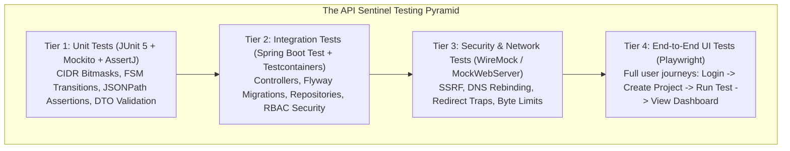
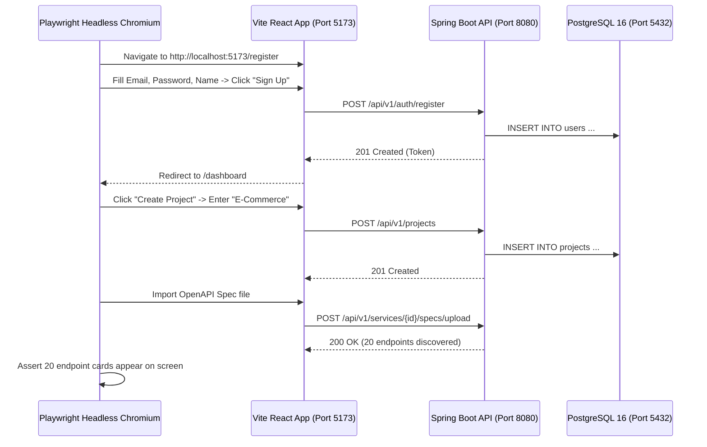

# API Sentinel — Comprehensive Testing & Quality Assurance Strategy

## 1. Testing Philosophy & Quality Engineering Standards

In API Sentinel, quality assurance is an engineering core invariant, not an afterthought. Every phase requires automated test coverage satisfying the **Definition of Done** before advancement:
1. **Zero Untested Claims**: Never claim a test passes without executing it and verifying the test result.
2. **Deterministic & Isolated**: Tests must not depend on external live networks or execution order. Network interactions use local mock HTTP servers (`MockWebServer` / `WireMock`).
3. **Comprehensive Edge-Case Testing**: Every module requires tests for happy paths, boundary conditions, invalid inputs, authorization violations, and timeout failures.



---

## 2. Testing Tiers & Tooling

| Tier | Scope | Frameworks & Libraries | Execution Speed |
|---|---|---|---|
| **Tier 1: Unit Tests** | Domain models, algorithms, bitwise CIDR matching, FSM transitions, variable extraction, assertion logic | JUnit 5, Mockito, AssertJ | < 5 milliseconds / test |
| **Tier 2: Integration Tests** | Spring MVC controllers, Spring Security filters, JWT validation, Flyway migrations, JPA queries | `@SpringBootTest`, `@AutoConfigureMockMvc`, Testcontainers (PostgreSQL), H2 test profile | 100 - 500 ms / test |
| **Tier 3: Security & Network Tests** | SSRF protection, anti-DNS rebinding, redirect traps, timeout handling, stream cutoff | OkHttp `MockWebServer`, custom `InetAddress` stubbing | 50 - 200 ms / test |
| **Tier 4: E2E Browser Tests** | Frontend user journeys, authentication persistence, chart rendering, error boundary alerts | Playwright (TypeScript) | 2 - 5 seconds / test |

---

## 3. Detailed Test Catalog by Module

### 3.1 Network Defense & SSRF Engine Tests (`net`)
The most critical security module requires exhaustive boundary test cases:

```java
// Example Unit Test Structure for CidrBlocklist
@Test
void shouldBlockLoopbackAndPrivateIps() {
    assertThat(cidrBlocklist.isBlocked(InetAddress.getByName("127.0.0.1"))).isTrue();
    assertThat(cidrBlocklist.isBlocked(InetAddress.getByName("10.0.0.1"))).isTrue();
    assertThat(cidrBlocklist.isBlocked(InetAddress.getByName("172.16.5.10"))).isTrue();
    assertThat(cidrBlocklist.isBlocked(InetAddress.getByName("192.168.1.100"))).isTrue();
    assertThat(cidrBlocklist.isBlocked(InetAddress.getByName("169.254.169.254"))).isTrue(); // Cloud metadata
    assertThat(cidrBlocklist.isBlocked(InetAddress.getByName("::1"))).isTrue(); // IPv6 loopback
}

@Test
void shouldAllowLegitimatePublicIps() {
    assertThat(cidrBlocklist.isBlocked(InetAddress.getByName("93.184.216.34"))).isFalse(); // example.com
    assertThat(cidrBlocklist.isBlocked(InetAddress.getByName("8.8.8.8"))).isFalse();
}
```

- **SSRF-01**: Loopback address rejection (`127.0.0.1`, `localhost`, `::1`).
- **SSRF-02**: RFC 1918 private address rejection (`10.0.0.0/8`, `172.16.0.0/12`, `192.168.0.0/16`).
- **SSRF-03**: Cloud metadata address rejection (`169.254.169.254`, `metadata.google.internal`).
- **SSRF-04**: Public IP allow verification (`93.184.216.34`, `1.1.1.1`).
- **SSRF-05**: Anti-DNS rebinding test: Server resolves to public IP, socket connection verifies pinned IP directly without secondary DNS lookup.
- **SSRF-06**: Redirect trap test: External URL issues `302 Found` with `Location: http://169.254.169.254/latest/meta-data/`. Interceptor catches and rejects redirect.
- **SSRF-07**: Stream quota test: Target streams a 10MB file. Client forcibly terminates connection at 5MB, logging `RESPONSE_SIZE_EXCEEDED`.
- **SSRF-08**: Connect/Read timeout test: Target delays response past 10s. Client throws `SocketTimeoutException`.

---

### 3.2 Authentication & Authorization Tests (`auth`)
- **AUTH-01 (Registration Success)**: Valid email, password, full name creates User, hashes password with BCrypt, returns 201 with sanitized User DTO.
- **AUTH-02 (Duplicate Email)**: Attempting to register existing email returns 409 Conflict with RFC 7807 problem details.
- **AUTH-03 (Weak Password)**: Password under 10 chars or missing numbers/symbols returns 400 Validation Error.
- **AUTH-04 (Login Success)**: Correct credentials return valid JWT access token and refresh token.
- **AUTH-05 (Invalid Password)**: Wrong password returns 401 Unauthorized; does not reveal whether email or password was wrong.
- **AUTH-06 (Token Expiration)**: Expired access token returns 401 with `TOKEN_EXPIRED` code.
- **AUTH-07 (Refresh Rotation)**: Valid refresh token produces new access token and invalidates old refresh token.
- **AUTH-08 (Refresh Reuse Detection)**: Replaying an already-revoked refresh token revokes all user sessions.

---

### 3.3 Projects & Multi-Tenant BOLA Tests (`projects`)
- **PROJ-01 (Project Creation)**: User creates project; automatic slug is generated and user is added as `OWNER`.
- **PROJ-02 (BOLA Cross-Tenant Isolation)**: User B attempts `GET /api/v1/projects/{userA_projectId}`. Returns 404 Not Found or 403 Forbidden.
- **PROJ-03 (Role Enforcement - Viewer)**: `VIEWER` attempts `POST /api/v1/projects/{id}/services`. Request is rejected with 403 Forbidden.
- **PROJ-04 (Role Enforcement - Editor)**: `EDITOR` successfully registers API service.

---

### 3.4 OpenAPI Import & Discovery Tests (`discovery`)
- **SPEC-01 (Valid OpenAPI 3.0)**: Ingests Petstore specification JSON; verifies all 20 endpoints are extracted with path, method, and schema.
- **SPEC-02 (Valid OpenAPI 3.1 YAML)**: Ingests YAML format; verifies accurate parsing.
- **SPEC-03 (Spec Drift Detection)**: Ingests Spec v1 (5 endpoints), then Spec v2 (4 original, 1 updated, 2 new). Diff engine returns 2 new, 1 modified, 1 deprecated.
- **SPEC-04 (Circular Reference Defense)**: Ingests model with self-referencing relationship (`Parent -> Child -> Parent`). Parser detects cycle, enforces depth cap of 10, and completes without stack overflow.

---

### 3.5 Test Engine & Assertion Chaining Tests (`testing`)
- **TEST-01 (Status Assertion)**: Endpoint returning 200 passes `STATUS_CODE_EQUALS: 200`; endpoint returning 500 fails assertion.
- **TEST-02 (Latency Assertion)**: Response in 120ms passes `RESPONSE_TIME_LESS_THAN: 500`; response in 600ms fails assertion.
- **TEST-03 (JSONPath Assertion)**: Body `{"status": "UP", "version": "1.0.0"}` satisfies `$.status == 'UP'`.
- **TEST-04 (Chained Variable Extraction)**: Step 1 extracts `$.token` into `{{authToken}}`. Step 2 makes request with header `Authorization: Bearer {{authToken}}`. Verifies extracted variable is injected into outbound request.
- **TEST-05 (DAG Cycle Detection)**: Step A depends on Step B, Step B depends on Step A. DAG resolver detects cycle and throws validation error before running.

---

### 3.6 Security Scanner Tests (`security`)
- **SCAN-01 (Missing HSTS)**: Mock server responds without `Strict-Transport-Security`. Scanner emits HIGH severity finding with rule `SEC-HDR-001`.
- **SCAN-02 (Permissive CORS)**: Mock server responds with `Access-Control-Allow-Origin: *` and `Access-Control-Allow-Credentials: true`. Scanner emits HIGH severity finding.
- **SCAN-03 (Stack Trace Disclosure)**: Mock server returns 500 with `"org.springframework.web..."`. Scanner emits HIGH severity finding for info disclosure.
- **SCAN-04 (Unauthenticated Access)**: Sensitive endpoint (`/admin/users`) returns 200 without Authorization header. Scanner emits CRITICAL finding.

---

### 3.7 Health Monitoring & SLA Tests (`monitoring`)
- **MON-01 (Probe Recording)**: Scheduled probe pings mock endpoint; creates `HealthCheckRecord` with exact latency and 200 status.
- **MON-02 (Failure Threshold)**: Mock server returns 503. Probe increments `consecutive_failures`. After 3 failures, status flips `UP` $\rightarrow$ `DOWN`.
- **MON-03 (Percentile Calculation)**: Inserts 100 mock health records with known latencies. Asserts $p50$, $p95$, $p99$ calculations match mathematical values.

---

### 3.8 Incidents & State Machine Tests (`incidents`)
- **INC-01 (Automated Trigger)**: 3 consecutive probe failures trigger an `Incident` in `TRIGGERED` status.
- **INC-02 (FSM State Transitions)**:
  - `TRIGGERED` $\rightarrow$ `ACKNOWLEDGED` (valid).
  - `ACKNOWLEDGED` $\rightarrow$ `RESOLVED` (valid).
  - `RESOLVED` $\rightarrow$ `ACKNOWLEDGED` (invalid: throws `IllegalStateTransitionException`).
- **INC-03 (Auto-Recovery)**: Downtime probe recovers (returns 200). Incident transitions `TRIGGERED` $\rightarrow$ `AUTO_RECOVERED`.

---

### 3.9 Dashboard & Real-Data Tests (`dashboard`)
- **DASH-01 (Zero-Fake-Data Assertion)**: Inserts 5 APIs, 2 active incidents, and 12 health records. Calls `/api/v1/projects/{id}/dashboard/summary`. Verifies every JSON field matches exact SQL `COUNT(*)` and `AVG(...)` queries.

---

## 4. End-to-End (E2E) Browser Testing with Playwright

Playwright automates end-to-end user journeys against a running frontend and backend instance:



---

## 5. Manual Verification Protocol (Executed Each Phase)

Before marking any phase complete, execute this 8-step verification checklist:
1. **Compilation**: Run `./mvnw clean compile` $\rightarrow$ Verify zero compilation errors or deprecation warnings.
2. **Automated Tests**: Run `./mvnw test` $\rightarrow$ Verify 100% of unit and integration tests pass.
3. **Database Migration**: Run `./mvnw flyway:migrate` against a clean PostgreSQL container $\rightarrow$ Verify all migrations execute sequentially without error.
4. **Endpoint Health**: Query `GET http://localhost:8080/actuator/health` $\rightarrow$ Verify status is `"UP"`.
5. **Swagger UI**: Navigate to `http://localhost:8080/swagger-ui.html` $\rightarrow$ Verify all endpoints, request bodies, and responses are documented.
6. **Error Format Check**: Trigger an invalid input (e.g. empty email on registration) $\rightarrow$ Verify response uses RFC 7807 Problem Details.
7. **Security Verification**: Execute SSRF check against `127.0.0.1` and `169.254.169.254` $\rightarrow$ Verify request is rejected with 400.
8. **Git Cleanliness**: Run `git status` $\rightarrow$ Ensure no secrets, `.env` files, or temporary artifacts are uncommitted.
